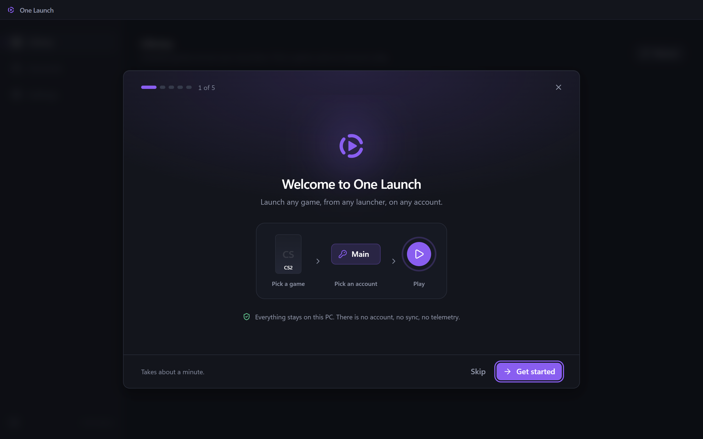

# One Launch

Launch any game, from any launcher, on any account.

One Launch keeps your game accounts in one place and shows every game you have installed. Pick a game, pick an account, press Play. One Launch switches the launcher to that account and starts the game. The launchers stay installed and still do the real work.

## Supported launchers

- Steam
- Epic Games
- Battle.net
- Riot Games

More are coming.

## What it does

- Keeps your accounts for each launcher, with tags and notes. Storing a password is optional.
- Shows all your installed games in one library, with artwork.
- The first time you use an account, you sign in once in the launcher. After that One Launch signs you in.

## Installing

One Launch is in beta. Download the installer from the [Releases](https://github.com/rjf2016/one-launch/releases) page.

You need Windows 10 or 11 (64-bit) and at least one of the launchers above.

Windows may warn you the first time you run the installer. Choose More info, then Run anyway. When it asks who to install for, pick "Only for me". That is the install that updates itself.

Uninstalling leaves your accounts and settings in `%APPDATA%\OneLaunch`. Delete that folder if you want them gone too.

## Privacy

Everything stays on this PC. There is no account, no sync, no telemetry, and no crash reporting to anyone.

- Passwords and saved sign-ins are encrypted by Windows and tied to your Windows user.
- Artwork comes from Steam's store, and from SteamGridDB if you add your own key. Only game names and ids are sent, nothing about you or your accounts. Settings › Artwork turns it off.
- One Launch checks this repository's releases for updates and installs a new version the next time it quits. Settings › Updates turns that off.
- Riot Games: One Launch never touches a Riot game or Vanguard, and never contacts Riot's servers.

Found a security problem? See [SECURITY.md](SECURITY.md).

## Licence

MIT. See [LICENSE](LICENSE).
